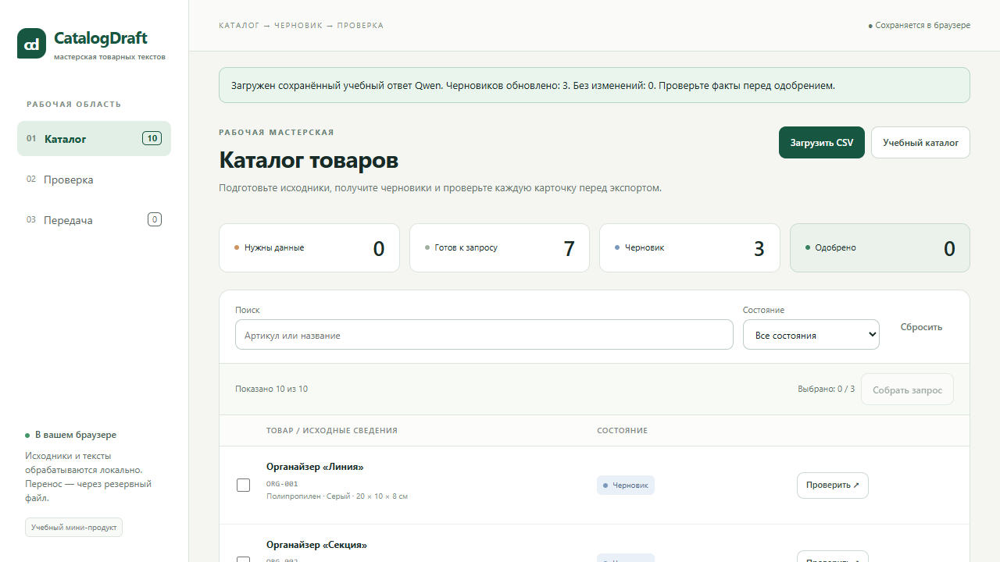

# CatalogDraft

**Turn a small product table into a reviewed copy handoff.** A local-first workspace for checking product facts, exchanging a structured prompt/response with Qwen, editing drafts and exporting only approved cards.

[Open demo](https://ergon73.github.io/catalogdraft/) · [Русская инструкция](README.ru.md) · [Rules](docs/rules.md) · [Verification](docs/checks.md)




## One complete workflow

1. Load a UTF-8 product CSV or try ten synthetic demo products.
2. Select up to three products and copy/download a fact-only prompt.
3. Manually take the prompt to Qwen and import its JSON response.
4. Compare the draft with the source facts, edit it and explicitly approve it.
5. Download all approved cards as CSV. Save/restore a JSON backup to move the whole workspace.

**There is no live model call in the application.** The demo response is an actual saved Qwen response, clearly labelled. No API keys, account, backend or external runtime dependencies are needed.

## What this project demonstrates

- Separate pure business logic, browser storage and UI.
- Atomic validation of CSV, model responses and backups.
- A catalogue identifier binds the model response to the current source table.
- Identical re-imports preserve edits and approvals; changed text invalidates approval.
- Human review is an explicit step, not a property trusted from model output.
- Search/filter do not silently alter the approved export.
- Storage denial and corrupt data have visible recovery paths.
- Responsive Russian UI, keyboard navigation and accessible confirmation dialogs.
- Unit tests and browser tests, including downloaded files and recovery in a fresh context.

This is an educational portfolio project, not a client deployment. All products and properties in the demo are fictional. It complements data collection and inventory workflows with the human review stage before publishing copy.

## Run

Open `index.html` after extracting the application archive, or open the demo above. Local files are linked with ordinary scripts; no build is required.

For a local HTTP preview with Node.js 24+:

```bash
npm run serve
```

Open `http://127.0.0.1:8781/`. The server binds to loopback only.

## Input and output

CSV: UTF-8, optional BOM, semicolon separator, 1–20 products, maximum 100 KB. Use [the example](demo/products.csv):

```text
sku;name;material;color;width_cm;depth_cm;height_cm;pack_qty
```

Missing or invalid product facts remain visible as **Needs data**. Structural errors, duplicate/empty SKUs and malformed files reject the whole import. Changing source facts requires explicitly replacing the source CSV; an identical normalized CSV keeps the workspace intact.

Model responses use `catalogdraft.response.v1`. Backups use `catalogdraft.backup.v1`. They are deliberately different contracts. The application rejects surrounding prose/Markdown, wrong fields, unknown/duplicate SKUs and responses for a different catalogue.

Export columns:

```text
sku;title;bullet_1;bullet_2;bullet_3;bullet_4;description
```

All approved cards are exported, regardless of the current filter. CSV uses UTF-8 BOM, semicolons and quoted fields when necessary. Spreadsheet-like formula prefixes are neutralized with an apostrophe in exported text cells; in-app content is not rewritten.

## Data and AI boundaries

- Files are processed in the browser; the application makes no network requests for data or generation.
- `localStorage` is scoped to this browser and origin. It is not a shared database. Different local paths/origins can have separate storage.
- Backups contain product facts, drafts and approvals. Restore replaces the current workspace after full validation and confirmation.
- If storage is blocked, the app works in memory and warns the user to download a backup. Corrupt saved content is not silently replaced.
- Schema validation does not establish factual truth. The reviewer checks material, colour, dimensions, packaging and unsupported claims.
- This is a generic copy-handoff CSV, not an official marketplace upload template. No automatic listing publication occurs.
- Unsaved editor changes are guarded during in-app navigation; save a draft before closing the browser.

## Test

```bash
npm ci
npx playwright install chromium
npm test
npm run test:e2e
```

For an already installed Chrome on Windows, PowerShell can use `$env:PW_CHANNEL='chrome'` before the browser suite. CI installs Chromium and uses Node 24. Tests never call Qwen or paid APIs.

13 unit tests cover contracts, transitions, CSV escaping and recovery. Eight browser scenarios cover the review chain, re-import, catalogue replacement, error handling, backup restore in a new context, cancellation, storage faults, mobile layout and standalone `file://` opening. See [the actual verification record](docs/checks.md) for results and limits.

## AI provenance

The code was implemented with Codex from an agreed project brief. Qwen3.7-Plus (Auto mode) produced three demo drafts on 2026-11-05. A follow-up disambiguated the third title's material/colour wording. The response is saved without inventing a model conversation. [Prompts](docs/prompts.md) · [Demo provenance](demo/README.md) · [Case study](docs/case.md).

## Structure

`logic.js` — pure contracts and transitions; `storage.js` — local persistence; `ui.js` — three screens; `demo-data.js` — embedded synthetic sources and saved response. No framework, build step or runtime package.

MIT licence. Author: [Georgy Belyanin](https://github.com/ergon73).
